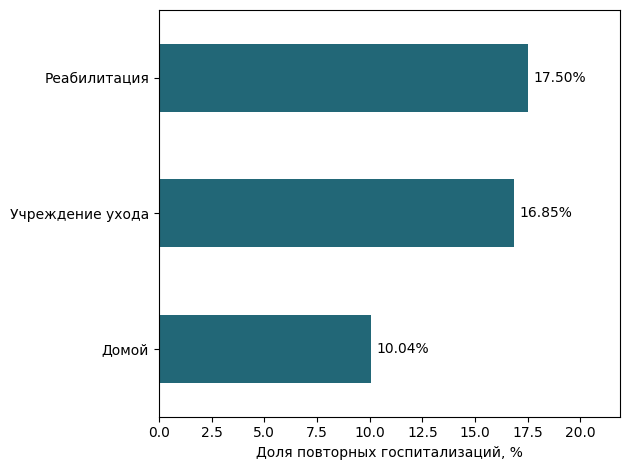

# Лабораторная работа 3. Построение ETL и ELT-пайплайнов

**Вариант 6**

## Сценарий и архитектура

Сценарий ежедневной отчётности адаптирован под витрину повторных госпитализаций по направлению выписки и полу. Запуск запланирован на 05:00 по Новосибирску, обработка должна закончиться до 06:00, витрина должна быть доступна к 07:00. В синтетической выгрузке нет дат госпитализации. Расписание задаёт частоту обновления, а витрина показывает долю повторных поступлений по всем принятым записям.

Выбран ELT. Python проверяет контракт и отделяет ошибочные строки перед загрузкой. DuckDB хранит принятые исходные поля, а dbt выполняет типизацию, разбор давления, соединение со справочником и агрегацию внутри базы. При 30 тысячах строк DuckDB и локальный Prefect работают на одной машине без облачной оплаты. В варианте ETL эти преобразования выполнялись бы в Python перед загрузкой, с отдельным повторным расчётом при изменении правил. Полные снимки удобны для отката в лаборатории, но объём хранения растёт с каждой изменившейся выгрузкой.

~~~mermaid
flowchart LR
    A[CSV] --> B[Prefect: извлечение]
    B --> C[Контракт CSV и GX]
    C --> D[DuckDB: MERGE и снимок]
    C --> Q[DLQ и алерт]
    D --> E[dbt: staging, справочник, факты, витрина]
    E --> F[GX и проверка итогов]
    F --> G[Витрина и метрики]
~~~

| Требование | Реализация |
|---|---|
| Повторная загрузка | Ключ SHA-256 от источника и `patient_id`. `MERGE` меняет строку только при новом хеше содержимого. |
| Временные сбои | До трёх ретраев Prefect с задержками 1, 2 и 4 секунды. Сбой до фиксации `MERGE` откатывает транзакцию. |
| Ошибки данных | Строка, причина и хеш выгрузки сохраняются в `ops.dlq`. Повтор той же выгрузки не дублирует записи DLQ. |
| Изменение схемы | Дополнительные поля игнорируются, `patient_age` приводится к `age`. При несовместимой схеме витрина остаётся на предыдущем состоянии. |
| Контроль и мониторинг | GX до загрузки и после dbt, тесты ключей и сверка агрегатов в dbt, время по этапам и предупреждения при появлении ошибок или превышении 15 минут. |

## Результаты проверки

| Проверка | Результат |
|---|---|
| Исходная загрузка | 30 000 строк, 9 групп, 3 674 повторных поступлений (12,25%). |
| Повтор той же выгрузки | 30 000 строк и столько же уникальных ключей. 0 изменений, версия 1. |
| Сбой и изменение выгрузки | Все 5 задач завершились со второй попытки. Обновлена 1 строка, 1 дубль пропущен, 1 строка с ошибкой давления в DLQ. |
| Несовместимая схема | Загрузка остановлена. В DLQ всего 2 записи: ошибка давления и несовместимый заголовок. |
| Time Travel | Возраст тестовой строки 74 → 75 в версиях 1 и 2. Версия 3 восстановила состояние версии 1. |
| Тесты | GX 6/6 до загрузки и 6/6 после dbt, 8 тестов dbt прошли. Контрольный тест GX выявил ошибку. |

Время первого прогона с генерацией документации dbt — 25,39 с. По этапам: извлечение 0,08 с, контракт и GX 3,15 с, MERGE 0,94 с, dbt build 12,34 с, проверка витрины 0,63 с. Метрики сохранены в [результатах прогона](results/verification.json).

[Prefect UI](assets/prefect.png) показывает зависимости задач, [dbt Docs](assets/dbt.png) — зависимости моделей. [HTML-отчёт GX](results/gx.html) содержит входные и выходные проверки, включая тест с отрицательной длительностью госпитализации.

## Проверка выпуска

GitHub Actions запускает тесты и отдельный staging-прогон. Локально проверены canary на первых 1 000 строках, smoke-тест полной витрины и автоматический возврат к предыдущей версии после сбоя проверки. При сравнении версий записываются время, доля принятых строк и изменение доли повторных госпитализаций. Статусы двух прогонов — `published` и `rolled_back`. [Метрики выпуска](results/release.json). Production-развёртывание в лабораторной имитируется переключением файла `current.json`.

**Вывод.** Повторный запуск сохранил объём витрины и версию данных. Prefect восстановил обработку после временных сбоев, а несовместимая схема остановила загрузку и сохранила причину в DLQ.
