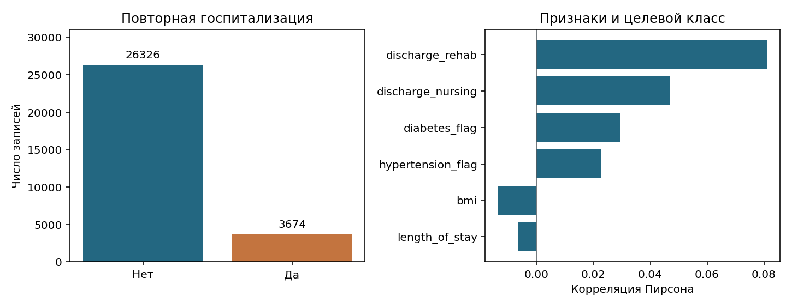
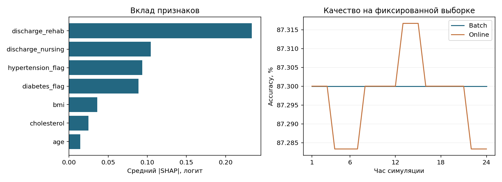
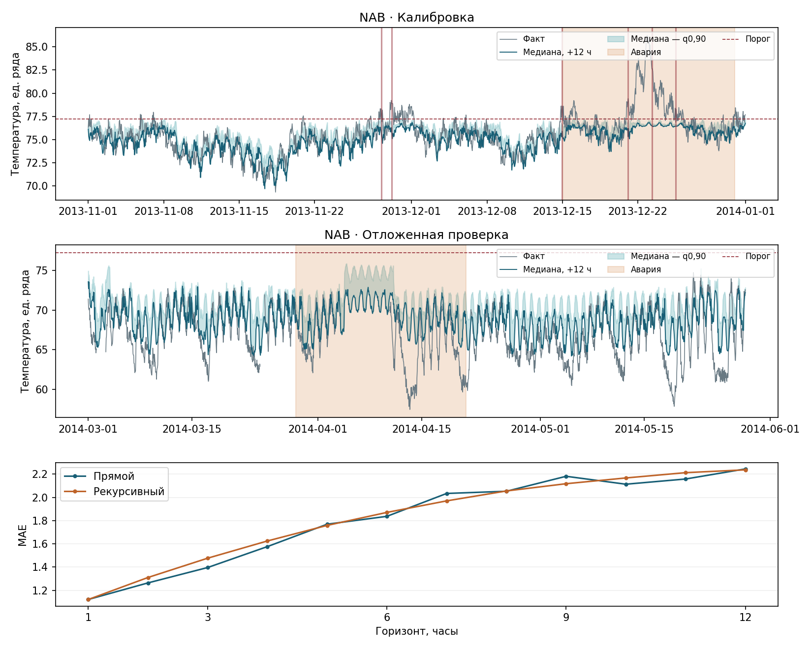

# Лабораторная работа 4. Интеграция ML-моделей в production

**Вариант 6**

## Модель и признаки

Сценарий выявления редких событий адаптирован под оценку риска повторной госпитализации в течение 30 дней. Модель получает признаки на момент выписки. Данные синтетические. Сравнение batch и online выполнено на симуляции, поскольку дат госпитализаций в выгрузке нет.

В наборе 30 000 записей, из них 3 674 с повторной госпитализацией (12,25 %). Дубликатов идентификатора 0, пропусков в исходных полях 0. Стратифицированное разбиение: 18 000 / 6 000 / 6 000 для обучения, валидации и теста. Feast использовал 11 признаков из одной версии схемы. На 256 пациентах проверены Parquet, SQLite и прямой расчёт, максимальное расхождение 0,0.

~~~mermaid
flowchart LR
    A[CSV] --> B[Признаки выписки]
    B --> C[Feast offline: Parquet]
    C --> D[Обучение и MLflow Registry]
    C --> E[Feast online: SQLite]
    D --> F[FastAPI]
    E --> F
    F --> G[Сводка метрик и дрейфа]
    G --> D
~~~

| Модель | ROC AUC | AP |
|---|---:|---:|
| Логистическая регрессия | 0,551 | 0,149 |
| Случайный лес | 0,559 | 0,150 |
| Градиентный бустинг | 0,550 | 0,147 |

Выбрана логистическая регрессия. На валидации она уступила случайному лесу 0,008 ROC AUC и позволила точно разложить логит по признакам. Порог уведомления выбран с целевым FPR до 0,7 %. На отложенном тесте FPR составил 0,84 %, полнота — 0,95 %. При таком пороге модель выявляет только небольшую долю случаев.

## Инференс и интерпретируемость

На 240 запросах к FastAPI p50/p95/p99 составили 5,05 / 5,59 / 6,03 мс, пропускная способность — 195,0 запроса/с, ошибок — 0. Некорректный идентификатор дал HTTP 422, отсутствующий в Feast — HTTP 404.

SHAP объясняет логит, его сумма восстановила вероятность до численной погрешности. Наибольшие средние вклады у `discharge_rehab`, `discharge_nursing` и `hypertension_flag`. С объяснением p95 составил 7,71 мс, изменение 2,12 мс при одинаковых прогнозах.

В MLflow пакетная версия 1 получила алиас `champion`, онлайн-версия 2 — `candidate`. Shadow вернул ответы основной модели, в canary кандидат получил 11 из 240 запросов при целевой доле 5 %. После введённой ошибки переключение отменилось, API вернулся к версии 1.

## Обновление модели и мониторинг

| Стратегия | ROC AUC | Accuracy | p95 API |
|---|---:|---:|---:|
| Batch | 0,577 | 87,13 % | 5,59 мс |
| Online | 0,575 | 87,20 % | 5,88 мс |

За 24 имитированных часа выполнено 24 обновления `partial_fit`. В потоке 8 981 меток поступили с дополнительной задержкой после созревания. Разница ROC AUC (online минус batch) составила -0,0013. Суммарное время обновлений 0,054 с без стартового обучения, один пакетный fit занял 0,031 с. Пакетная схема проще в эксплуатации при задержке метки в 30 дней. Онлайн-схема обрабатывает дозревшие метки чаще, для неё нужны поток и контроль их поступления.

Контрольное окно дало PSI 0,014, искусственный сдвиг — 3,340. Падение accuracy на 23,27 п. п. сопровождалось локальным алертом. Проверялись также KS, пропуски, диапазоны и PSI прогнозов. При PSI выше 0,30, падении accuracy выше 15 п. п. или недельном запуске создаётся кандидат на переобучение. В демонстрации retrain создал версию 3, действующий `champion` сохранился.

## Прогноз температуры и автоотключение

LightGBM сравнивался в прямой и рекурсивной схемах до 12 часов. Обучение завершено на данных по 31 октября 2013 года. Ноябрь и первая авария использованы для настройки, авария 29 марта — 20 апреля 2014 года оставлена для финальной проверки. Пропуски в лагах заполнялись только предыдущими значениями, до трёх часов подряд.

Тревога требует одновременного превышения порога вероятности, сигнала CUSUM, сохранения нарушения несколько часов и завершения cooldown. Вероятность оценивалась снизу по квантилям. При настройке условные затраты на реакцию оператора, лишний простой и пропуск отказа получили веса 1, 3 и 8 соответственно. Уведомление, сброс нагрузки и отключение воспроизводились в симуляции.

| Горизонт | Прямой MAE / MASE / pinball | Рекурсивный MAE / MASE / pinball |
|---|---:|---:|
| 1 ч | 1,120 / 0,641 / 0,252 | 1,120 / 0,641 / 0,211 |
| 6 ч | 1,837 / 1,051 / 0,411 | 1,871 / 1,071 / 0,433 |
| 12 ч | 2,245 / 1,285 / 0,430 | 2,237 / 1,281 / 0,521 |

К 12 часам точечные ошибки сблизились, а прямой прогноз дал меньшую ошибку верхнего квантиля. Вертикальные линии на графике отмечают уведомления.

Порог температуры — 77,22, вероятность выше 10,00 %, подтверждение 4 ч, cooldown 48 ч. На калибровке опережение 1 ч, precision 66,67 %, recall 100,00 %, ложных тревог 2 (0,033 в день), ложных отключений 1. На отложенном окне тревог 0, ложных в день 0,000, пропущена 1 авария, recall 0,00 %. Precision и опережение не определены из-за отсутствия тревог. Во время второй аварии максимум 72,29 остался ниже порога. Контур перегрева не подходит для самостоятельного автоотключения при таких отказах.

[Ноутбук](lab_4.ipynb) · [Эксперименты MLflow](assets/mlflow.png) · [Реестр MLflow](assets/registry.png) · [Метрики модели](results/hospital_metrics.json) · [Прогноз и журнал NAB](results/sensor_metrics.json)
