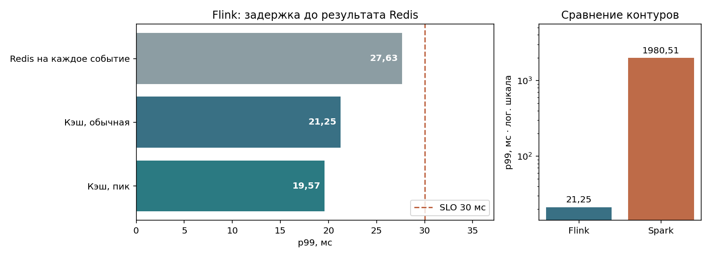

# Лабораторная работа 5. Проектирование систем потоковой обработки

**Вариант 6**

## Архитектура

Сценарий выявления редких событий адаптирован под оценку риска повторной госпитализации на момент выписки. Даты в синтетическом датасете отсутствуют, поэтому временной порядок и нагрузка воспроизводятся генератором. Целевое требование к контуру — **p99 < 30 мс**.

~~~mermaid
flowchart LR
    A[Генератор событий] --> K[Kafka KRaft]
    K --> F[Flink: валидация, время события, окна]
    F --> O[ONNX Runtime]
    R[Redis: снимок признаков] --> O
    O --> S[Redis: прогнозы и оконные агрегаты]
    F --> L[Side outputs: late и DLQ]
    K --> X[Spark: микробатч с ONNX]
    X --> S
    F --> P[Prometheus и Grafana]
~~~

| Требование | Решение |
|---|---|
| Низкая задержка | Flink обрабатывает события по одному с двумя параллельными подзадачами. ONNX-сессия открывается один раз, снимки Redis кэшируются. |
| Время события | Окна 10 с по пациенту, watermark отстаёт на 2 с. В пределах ещё 3 с после конца окна опоздавшие обновляют агрегат. После закрытия они идут в late-выход. |
| Восстановление | Checkpoint Flink каждые 10 с сохраняет Kafka offsets, состояние и таймеры. Redis `SET NX` фиксирует единственный результат по идентификатору события или окна при повторной доставке. TTL дедупликации в состоянии — 24 часа. |
| Контроль | Lag по подтверждённым смещениям Kafka, p99 по фазам, доля поздних событий, PSI, длительность и размер checkpoint. Некорректные записи сохраняются в DLQ. |

Прогнозы становятся видны сразу после записи в Redis. Checkpoint фиксирует прогресс независимо. Spark выполняет чтение Redis и ONNX пакетно, но добавляет ожидание запуска микробатча. У стенда одна машина и один брокер. Проверка восстановления относится к отказам обработчиков. Для отказа хоста нужна репликация хранилищ.

## Измерения

Оба контура запускались в Docker Desktop с 8 vCPU и 7,68 ГиБ RAM. Время измерялось от вызова Kafka producer до первого чтения результата из Redis. Прогрев исключён, в каждой фазе Flink использовано по 1 000 событий. В таблице указаны заданная интенсивность и фактический throughput.

| Контур | Событий/с, цель → факт | p50, мс | p95, мс | p99, мс |
|---|---:|---:|---:|---:|
| Redis на каждое событие | 50 → 49,9 | 4,68 | 12,94 | 27,63 |
| Кэш, обычная | 50 → 49,9 | 3,85 | 9,89 | 21,25 |
| Кэш, пик | 100 → 99,6 | 3,84 | 9,75 | 19,57 |
| Spark, микробатч | 150 → 90,7 | 1130,32 | 1895,18 | 1980,51 |

Задержка Flink p99 в обычной и пиковой фазах была ниже 30 мс. При кэшировании p95 этапа чтения признаков снизился с 1006,05 до 8,41 мкс. p95 ONNX в обычной фазе — 522,35 мкс. В общую задержку входят Kafka, маршрутизация, запись и опрос Redis. Spark пакетно читает Redis и выполняет ONNX. Его p99 составил около 2 с.

При 100 и 200 событиях/с до настройки p99 был 43,81 / 50,14 мс. В финальной конфигурации ожидание fetch ограничено 10 мс, healthcheck Kafka заменён TCP-проверкой, включён ZGC, интервал checkpoint увеличен до 10 с, у producer включён TCP_NODELAY. Основной и боковые выходы разделены. При задержке выравнивания свыше 5 мс используются unaligned checkpoints. В финальной конфигурации при 100 и 200 событиях/с p99 был 25,01 / 60,57 мс. Пик 200 не прошёл проверку. [История замеров](results/flink_trials.json).

Модель `readmission-v1` экспортирована из логистической регрессии. Для обучения использованы 18 000 из 30 000 записей. На отложенном тесте ROC AUC 0,576, FPR 0,65 %, полнота 0,54 %. На 128 событиях каждого контура расхождение признаков batch и stream равно 0,0 для Flink и 0,0 для Spark. Максимальное расхождение прогнозов: Flink 7.4e-09, Spark 0.0e+00.

## Надёжность и мониторинг

Одно опоздавшее событие обновило открытое окно. Второе попало в late-выход с причиной `window_closed`, запись с нулевой длительностью госпитализации — в DLQ с причиной `invalid_features`. Контрольное окно содержало 3 уникальных записи, включая одну позднюю.

После сбоя сразу после записи в Redis Flink сохранил 41 результат без потерь. Номер checkpoint вырос с 34 до 35. В отдельном тесте при остановке TaskManager в Kafka накопилось 80 событий. После запуска обработаны все 80, lag вернулся к нулю. В Spark после аварии драйвера сохранился 41 результат без дубликатов.

После сдвига BMI PSI составил 6,549 при пороге 0,2. Порог поздних событий 5 % проверялся на специально сформированной серии. При росте lag проверяются чтение Kafka и состояние TaskManager, при росте p99 — время Redis и очередь, при дрейфе — версия входных признаков. Размер состояния в снимке — 694,4 КиБ, длительность checkpoint после восстановления — 72 мс. Снимки JVM TaskManager без кэша и с ним: heap 207,8 → 73,2 МиБ, CPU 7,0 → 4,9 %.

[Grafana](assets/grafana.png) · [Flink UI](assets/flink.png) · [Алерты](results/alerts.json) · [Замеры Flink](results/flink.json) · [Замеры Spark](results/spark.json) · [Отказ TaskManager](results/node.json)
