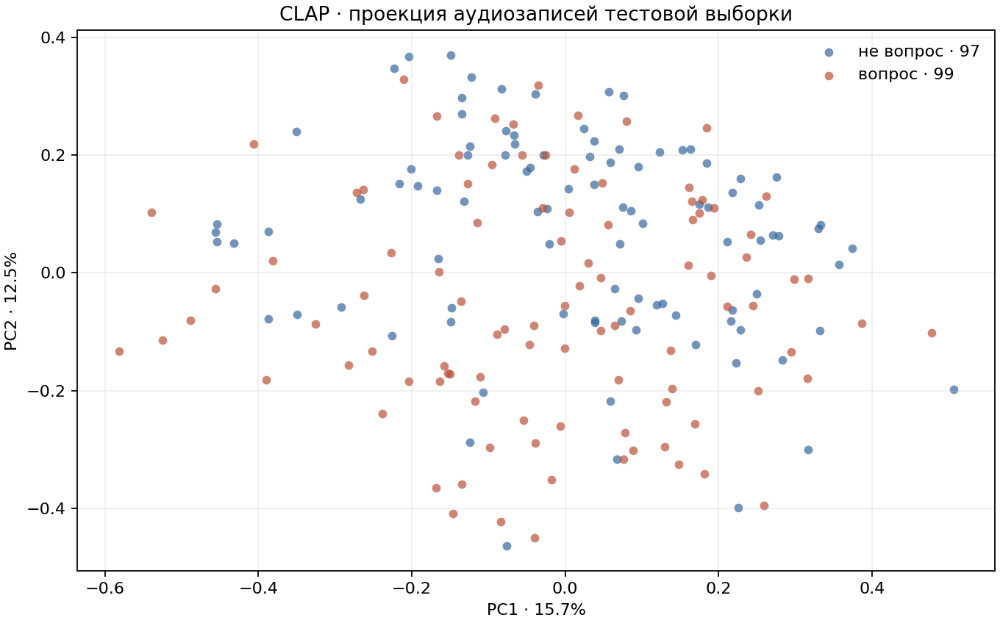

# Лабораторная работа № 7. Мультимодальный датасет

Вариант 6

## 1. Данные и подготовка

Сценарий — разметка вопросов и поиск похожих записей в аудиокаталоге. Из русских частей `dev` и `test` Common Voice 17.0 отобраны 1 000 MP3 от 706 дикторов, поровну вопросов и прочих фраз. Метка берётся из последнего знака транскрипта. Ключ соединения — имя клипа без расширения. В TSV также есть возраст и пол. Эти поля сохранены для проверки пропусков и исключены из обучения.

MP3 декодировали в моно, ресемплировали до 48 кГц и привели к окну 10 с. Штатный препроцессор CLAP вычислил 64 log-mel полосы с паддингом `repeatpad`. На Intel Core i5-9300H подготовка 64 клипов заняла 3,27 с, всех 1 000 — 48,20 с. CLAP кодировал батчи по 8 за 126,78 с. Повторное чтение Parquet заняло 21 мс.

Полный препроцессинг двух шардов, 20 406 записей, занял 370,71 с в четырёх процессах. Для всей русской версии из 153 тыс. записей линейная оценка составляет около 46 минут. В этот замер входит декодирование и расчёт log-mel, без инференса CLAP.

## 2. Качество эмбеддингов

Замороженный CLAP вернул 512 признаков на клип. Максимальное отклонение L2-нормы от 1 составило 1,19 × 10⁻⁷. Классы на PCA перекрываются, а первые две компоненты объясняют 28,2 % дисперсии. В 40 аудиозапросах точные соседи дали precision@5 = 0,630. В двух примерах с разными классами совпали 4 из 5 меток. Текстовый запрос об утверждении нашёл 5 из 5 записей ожидаемого класса, запрос о вопросительной интонации — 2 из 5.

## 3. Соединение и защита от утечки

Соединение один к одному сохранило все 1 000 клипов. Для двух разбиений дикторов распределили по группам, а повторы нормализованных фраз удалили до разбиения. Полный транскрипт, пунктуация и идентификаторы не передавались в модель. Таблица содержит 4 признака из слов без пунктуации, аудио — 512, объединение — 516. PCA и модели обучались только на train.

## 4. Сравнение LightGBM

| Признаки | ROC-AUC / F1, seed 42 | ROC-AUC / F1, seed 2026 |
| --- | ---: | ---: |
| Таблица | **0,758 / 0,712** | **0,813 / 0,737** |
| Аудио | 0,700 / 0,627 | 0,741 / 0,711 |
| Таблица и аудио | 0,742 / 0,687 | 0,790 / 0,697 |

Добавление аудио снизило общий ROC-AUC на 0,016 и 0,023. На фразах длиннее 7 слов оно дало +0,033 при seed 2026 и −0,045 при seed 42. Для коротких фраз таблица была лучше на обоих разбиениях.

## 5. Векторный поиск

В LanceDB построен индекс IVF_FLAT по 804 векторам. Для 40 запросов проверили top-5 с предварительным фильтром по диапазону длительности и без него. Граница диапазонов — медиана train, 4,536 с. Задержка измерена для уже вычисленного вектора.

| Режим | Precision@5 по метке | Precision@5 по метке и длительности | Recall@5 к перебору | Медиана, мс |
| --- | ---: | ---: | ---: | ---: |
| Без фильтра | 0,645 | 0,505 | 0,985 | 6,28 |
| С фильтром | 0,620 | 0,620 | 0,990 | 7,65 |

## 6. Вывод

При доступном транскрипте для разметки вопросов достаточно табличной модели. Аудио полезно для поиска по звучанию, а фильтр повышает долю результатов, удовлетворяющих обоим условиям. Ограничения эксперимента — сбалансированная выборка из двух частей корпуса, метка по письменной пунктуации и два разбиения.

[Ноутбук](lab_7.ipynb) · [Замеры моделей и поиска](results/measurements.json) · [Замер полных шардов](results/source_preprocess.json)
