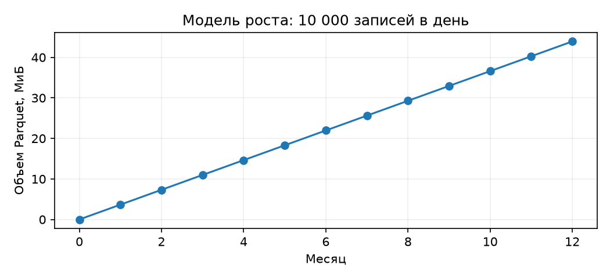
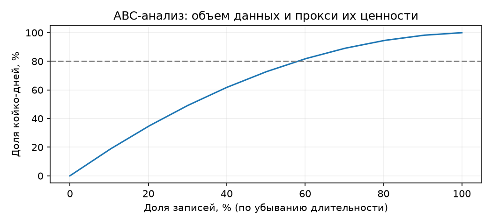
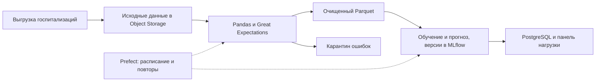
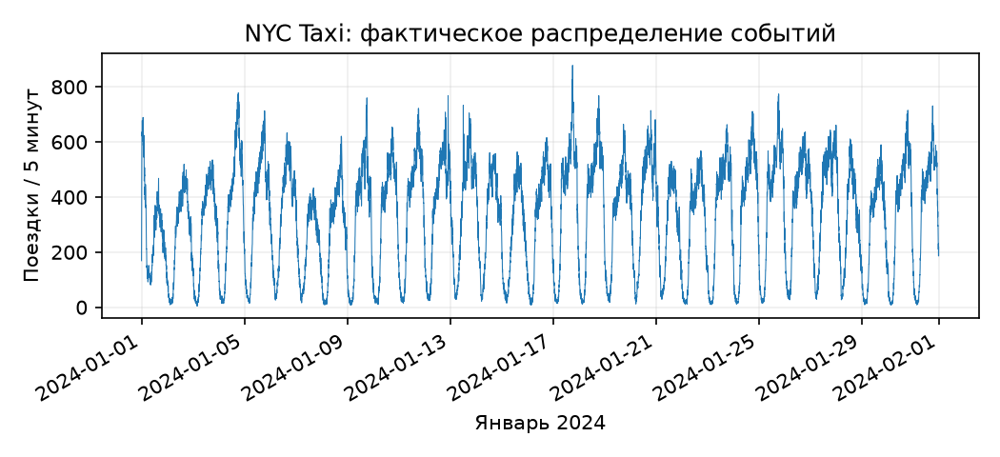

# Отчёт по лабораторной работе и практическому заданию «Введение в Big Data»

**Вариант 6**

## 1. Анализ Big Data-сценария: Hospital Readmissions

**Цель:** проанализировать данные по 5V и выбрать достаточные технологии для бизнес-задачи.

Использован именно [Hospital Readmission Prediction (synthetic dataset)](https://www.kaggle.com/datasets/siddharth0935/hospital-readmission-predictionsynthetic-dataset), на который ведёт ссылка варианта 6 в методичке: **30 000 строк, 12 столбцов**, файл `hospital_readmissions_30k.csv`. Это синтетические записи, а не сведения о реальных пациентах. Повторное поступление за 30 дней отмечено в **3 674 записях (12,25%)**.

**Сценарий № 3 — прогноз занятых коек:** ежедневно до 06:00 выдавать прогноз пикового числа занятых коек на следующие семь суток по учреждениям и отделениям; срез данных — 05:00. Целевая величина — максимум одновременно находящихся в отделении пациентов за каждые сутки, горизонты 1–7 дней. Бизнес-цель — сократить избыточно резервируемые койко-дни на 25% без роста дней с дефицитом относительно текущего планирования.

Нужны интервалы пребывания в отделении (`episode_id`, `hospital_id`, `department_id`, `start_ts`, `end_ts`, часовой пояс), история доступных коек и плановых поступлений, известных к 05:00; интервалы одного эпизода проверяются на неперекрытие. Календарь выходных/праздников включается в признаки; полезность погоды проверяется сравнением моделей, используя только прогноз погоды, известный к 05:00. Проверка — скользящий временной backtest, MAE по горизонтам 1–7 дней против базового прогноза «последнее доступное наблюдение того же дня недели»; никаких будущих сведений на входе.

В исходном наборе нет дат и отделений, поэтому временной прогноз не обучался. Метка повторного поступления используется в описательной статистике. Измерения относятся к файлу и ETL; будущий прогноз, нагрузка источников и экономика — проектная часть.

### 1.1. Volume — объём

Исходный CSV — **1,50 МиБ**, таблица в Pandas — **3,42 МиБ**, в Arrow — **3,42 МиБ**. Форматы измерены на одинаковых 30 000 строках после нормализации переводов строк CSV.

| Формат | Размер, МиБ | CSV / размер формата |
|---|---:|---:|
| CSV без сжатия | 1,47 | 1,00× |
| Parquet + Snappy | 0,36 | 4,07× |
| Avro + Deflate | 0,49 | 3,00× |
| Avro без сжатия | 1,65 | 0,89× |

Parquet выбран для аналитики по столбцам, Avro — альтернатива для обмена записями.

**Модель роста:** при 10 000 записей/сутки прирост Parquet — **0,12 МиБ/сутки**, за год — **43,93 МиБ**. Порог 1 ТБ будет превышен через **260 524 мес.**. Экстраполяция для текущей схемы предполагает неизменные скорость и сжатие; после добавления дат и отделений объём нужно пересчитать.



**Хранение:** последние 90 дней и агрегаты — в быстром доступе; старую историю — в архив, сохраняя данные для обучения и аудита.

По [тарифу Yandex Object Storage](https://yandex.cloud/ru/services/storage) STANDARD — 2,376 ₽/(ГиБ·месяц). Хранение полного годового объёма ещё 12 месяцев: `0,0429 × 2,376 × 12 = 1,22 ₽`. С учётом [бесплатного первого 1 ГиБ](https://yandex.cloud/ru/docs/storage/pricing) и отсутствия других объектов плата за хранение — **0 ₽**. Операции, трафик и вычисления — отдельно; тариф проверен 28.10.2026.

**Вывод:** достаточно Pandas. Для 8 ГиБ RAM при трёхкратном запасе ориентир — 2 ГиБ рабочей таблицы. При росте сначала читать частями; Spark нужен при нехватке одного узла или нарушении срока расчёта.

### 1.2. Velocity — скорость

Фактические события/с, пик и CV **не определяются без временных меток**. После добавления дат: `средняя = N / время`, `пик = max(N₅мин) / 300`, `CV = std(N₅мин) / mean(N₅мин)`, включая пустые интервалы.

**Основание сценария нагрузки:** 100 условных учреждений × 100 новых записей в сутки = 10 000 записей/сутки, или 0,116/с. Это масштаб проектирования, а не статистика Kaggle. Проектный предел импорта — 10 записей/с (например, пакет 3 000 за 5 минут); его предстоит подтвердить журналами реальных источников.

| Режим | Среднее ожидание при равномерном потоке | Максимальное ожидание запуска |
|---|---:|---:|
| Batch раз в час | 30 минут | до 60 минут |
| Micro-batch раз в 5 минут | 2,5 минуты | до 5 минут |
| Streaming | нет ожидания следующего пакета | зависит от очереди и обработки |

К ожиданию добавляются доставка и обработка. Достаточно ежедневного batch: запуск в 05:00, бюджет **60 минут = 3 600 000 мс**, результат до 06:00. SLA проверяется на пилоте.

Сбой на 30 минут задержит около **208 записей** при среднем потоке либо **18 000** при непрерывном пике. При сохранении источника и повторяемой загрузке потерь нет; нужны контроль полноты и идемпотентная запись.

**Проверка ресурсов:** выполнены три последовательных прогона медицинского ETL без сброса дискового кэша на двух логических CPU: чтение CSV → проверка/разбор давления → три проверки GX → агрегат → запись Parquet. Сравнение:

| Объём | Медиана ETL, с | Максимальный RSS, ГиБ |
|---|---:|---:|
| 30 000 исходных строк | 0,220 | 0,241 |
| 300 000 тестовых строк | 1,471 | 0,427 |

300 000 строк получены десятикратным повторением с уникальными тестовыми ID; даты не добавлялись. Импорты/инициализация GX заняли отдельно 6,10 с. При росте нагрузки в 10 раз время выросло примерно в 6,68 раза. Для такого ETL предлагаются **2 vCPU, 8 ГиБ RAM**: трёхкратный запас к измеренному максимуму RSS составляет 1,28 ГиБ; остальная память оставляется ОС и сервисам. Это оценка конфигурации: лимит RAM в эксперименте не задавался. Для годовой истории читать данные частями. Время обучения и полный SLA до 06:00 остаются предметом отдельного пилота.

### 1.3. Variety — структура

Типы исходника: **5 int, 1 float, 6 строковых полей**. По смыслу: ID, пять количественных признаков, пять категорий с целевой меткой и составное давление.

Неструктурированных данных — **0%**, вложенного JSON и геоданных нет; NLP не требуется. У `patient_id=1` давление `130/72` разбивается на `systolic=130`, `diastolic=72`. В очищенной таблице 13 полей: давление заменено двумя числами.

Хранение: исходный CSV → Parquet с числовыми полями давления → агрегаты PostgreSQL. Партиционирование по дате возможно только после её добавления; ID не заменяет дату.

### 1.4. Veracity — качество

| Проверка на 30 000 строках | Результат |
|---|---:|
| Пропуски по каждому из 12 полей | 0 / 0% |
| Полные дубликаты / повторяющиеся `patient_id` | 0 / 0 |
| Отрицательные числовые значения | 0 |
| Неразбираемый формат давления | 0 |
| Неверный порядок давления / диастолическое ≤ 0 | 0 |
| Длительность пребывания в диапазоне 1–10 дней | 30 000 / 100% |
| Целевая метка `Yes` или `No` | 30 000 / 100% |

Ошибок в проверенных полях исходника не найдено; `Other` — допустимая категория. Разбор давления: сначала маска формата, затем nullable `Int64`; неверные строки изолируются. Отдельный тест из 7 строк выявил 4 ошибки формата (`bad`, пропуск, `120/`, переполнение) и 1 ошибку порядка: все 5 попали в карантин, 2 корректные строки прошли. Программа не падает; исходные данные не подменялись. Синтетическая чистота не доказывает пригодность для реальной больницы.

**Great Expectations:** фактически выполнены проверки диапазона `length_of_stay`, уникальности `patient_id` и допустимых целевых меток; все три вернули `success=True`. Основная проверка:

```python
expectation = gx.expectations.ExpectColumnValuesToBeBetween(
    column="length_of_stay", min_value=1, max_value=10
)
result = batch.validate(expectation)
assert result.success
```

Ошибка в 1% меток затрагивает 300 записей: доля положительных ответов может сдвинуться на 1 п.п., а если затронут только положительный класс — до 8,17% его размера. Влияние на модель требует отдельного измерения.

Проверять каждую загрузку: неверные ключи и метки — в карантин, форматы — нормализовать, спорные значения — владельцу. Реальным данным нужны контроль доступа и шифрование; ML — защита от утечки будущих признаков.

### 1.5. Value — экономика

Связь с экономикой: по прогнозу планируется резерв коек. В пилоте считать стоимость избытка как `Σ max(запланировано − фактический пик занятости, 0) × цена койко-дня` и сравнивать с действующим планированием при сопоставимом потоке пациентов. Экономия засчитывается при отсутствии роста дефицита; сравнение проводится по отделениям с учётом календаря. **Суммы ниже — учебные допущения, не эффект, установленный на синтетике.**

| Показатель первого года | Допущение |
|---|---:|
| Годовые затраты на избыточное резервирование | 4 000 000 ₽ |
| Экономия при снижении избытка на 25% | 1 000 000 ₽ |
| Разработка | 300 000 ₽ |
| Вычисления и инфраструктура | 120 000 ₽/год |
| Поддержка | 80 000 ₽/год |
| Все затраты первого года | 500 000 ₽ |

`ROI = (1 000 000 − 500 000) / 500 000 × 100% = 100%`.
Окупаемость после запуска: `300 000 / ((1 000 000 − 200 000) / 12) = 4,5 месяца` при равномерной экономии. При снижении эффекта на 20% через год экономия будет 800 000 ₽; ROI при тех же затратах первого года — 60%.

**ABC-анализ:** записи отсортированы по длительности; койко-дни — заместитель операционной ценности, не доказанная прибыль. Всего 165 087 койко-дней.

| Класс | Число записей | Доля записей | Доля койко-дней |
|---|---:|---:|---:|
| A | 17 428 | 58,09% | 80,00% |
| B | 6 985 | 23,28% | 15,00% |
| C | 5 587 | 18,62% | 5,00% |

A включает записи до 80% койко-дней, B — до 95%, C — остаток; пересекающая порог запись включена. Верхние 20% записей дают **34,55%** койко-дней: 20/80 не подтверждается.



Приоритет — исходы, длительность, история и даты; ID не использовать как признак. Группы пациентов не отбрасывать. Ежедневно контролировать срок и ошибку прогноза, ежемесячно — дрейф и экономию, ежеквартально — ROI.

### 1.6. Технологии и внедрение

| Компонент | Выбор и причина | Ограничение / альтернатива |
|---|---|---|
| История | Object Storage + Parquet: компактность и выбор столбцов | Нет транзакционного обновления строк; Delta Lake при частых исправлениях, HDFS требует обслуживания |
| ETL | Pandas: текущий объём помещается на одном узле | Dask при обработке частями и параллелизме; Spark при росте и тяжёлых объединениях |
| ML | Простая базовая модель, затем scikit-learn; MLflow для версий экспериментов | Нужны реальные временные данные; online Feature Store пока избыточен |
| Оркестрация | Prefect: ежедневный запуск, повторные попытки, контроль срока | Airflow при большом числе зависимых процессов; оба требуют мониторинга |
| Выдача | PostgreSQL: прогнозы и агрегаты для панели | Kafka/Flink нужны при отдельном требовании оперативных событий, которого сейчас нет |



Риски: отсутствие дат → расширить схему; синтетика → реальный пилот; утечка ответа → контроль доступности признаков; сбой → повторная загрузка; дрейф → сравнение с базовой моделью и откат.

| Месяц | Этап | Критерий готовности |
|---|---|---|
| 1 | Получить интервалы по отделениям и календарь | Даты/отделение у ≥99% записей, проверки границ интервалов |
| 2 | Внедрить загрузку и проверки | Нет дубликатов ключей, ошибки изолированы |
| 3 | Прогноз коек на 7 дней и базовая модель | MAE по отделениям на скользящем временном backtest |
| 4 | Пилот и нагрузочный тест | Прогноз до 06:00 не менее 99% дней |
| 5 | Сравнить модели и планы резервирования | MAE ниже базового на 10%; дефицит не чаще исходного |
| 6 | Подтвердить экономию в пилоте | Стоимость избытка −25%, дефицит не растёт, ROI > 0 |

**Вывод:** важнее качество и ценность, чем распределённая обработка. Начать с одного узла и batch; бизнес-эффект подтвердить на реальной истории.

## 2. Практическое задание из лекции «Введение в Big Data»

### 2.1. NYC Taxi: краткий анализ 5V

Загружен официальный [NYC TLC Yellow Taxi, январь 2024](https://d37ci6vzurychx.cloudfront.net/trip-data/yellow_tripdata_2024-01.parquet): **число строк — 2 964 624, столбцов — 19**. Исходный Parquet занимает **47,65 МиБ**, записанный CSV — **296,22 МиБ**. Экстраполяция `месяц × 12` даёт **3,47 ГиБ CSV** и **0,56 ГиБ Parquet** за год; это оценка по январю без поправки на сезонность.

Для скорости учтены только 2 964 606 поездок с началом в январе: **3 984,69 записей/час**, средняя скорость **1,11/с**; максимум — **878 за 5 минут**, CV пятиминутных интервалов — **0,586**. Это частота начала поездок, а не скорость фактической отправки файлов в TLC.



Variety: временные метки, расстояние, суммы, категории платежа и идентификаторы зон. В этом выпуске география представлена кодами `PULocationID`/`DOLocationID`; координаты можно добавить через справочник зон, непосредственно координат GPS здесь нет.

Veracity: **60 371** поездок с нулевым расстоянием, **35 504** с отрицательной общей суммой, **18** с началом вне января и **870** с неположительной длительностью. Это флаги проверки: отрицательные суммы могут быть корректировками, поэтому удалять их без анализа причин нельзя. Value: прогноз спроса по зоне и часу помогает распределять машины и снижать пустой пробег; эффект проверяется по выручке на машино-час и доле холостого пробега.

### 2.2. Сравнение Pandas, Dask и PySpark на 10 ГБ

Локальный тест на единой методике: **10,000000 ГБ CSV**, 95 442 475 строк. Объём получен повторением январских записей NYC Taxi. Задача одинакова: прочитать CSV, посчитать сумму и число `total_amount` по `PULocationID`.

Сверены **все 260 зон**: ключи и количества совпали точно, максимальная разница сумм — **0,00002396** при допустимом абсолютном отклонении 0,001. Проверены и единый размер входа, и хеш исходного CSV; результаты по каждой зоне сохранены в JSON.

| Движок | Импорт и запуск, с | Запрос, с | RSS запроса, ГиБ |
|---|---:|---:|---:|
| pandas | 1,26 | 134,47 | 0,15 |
| dask | 3,12 | 114,91 | 1,39 |
| spark | 16,18 | 72,43 | 1,01 |

Pandas: части по 100 000 строк; Dask: 64 МиБ, 4 потока; Spark: `local[4]`, heap 2 ГиБ. У всех явные типы и чтение всех столбцов. Импорты всех библиотек и инициализация движка вынесены в отдельный таймер; таймер запроса включает чтение, агрегацию и получение полного отсортированного результата. RSS — абсолютная сумма памяти процесса и потомков, включая JVM, с опросом каждые 50 мс; измеряется именно фаза запроса. Остановка движка и запись JSON исключены у всех. Машина: 8 логических CPU, 15,85 ГиБ RAM. По одному последовательному прогону без очистки дискового кэша: различия времени остаются локальными, а не универсальным рейтингом.

**Вывод:** 10 ГБ обрабатываются частями на одном узле; Spark выбирают по времени, памяти и сложности, а не только размеру файла.